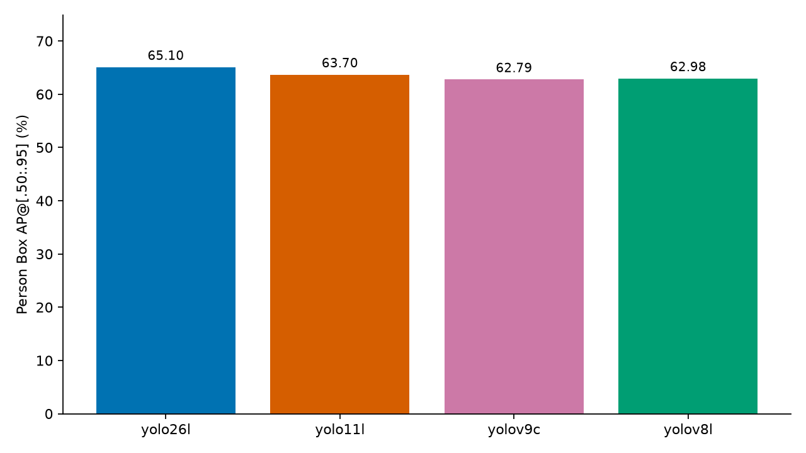
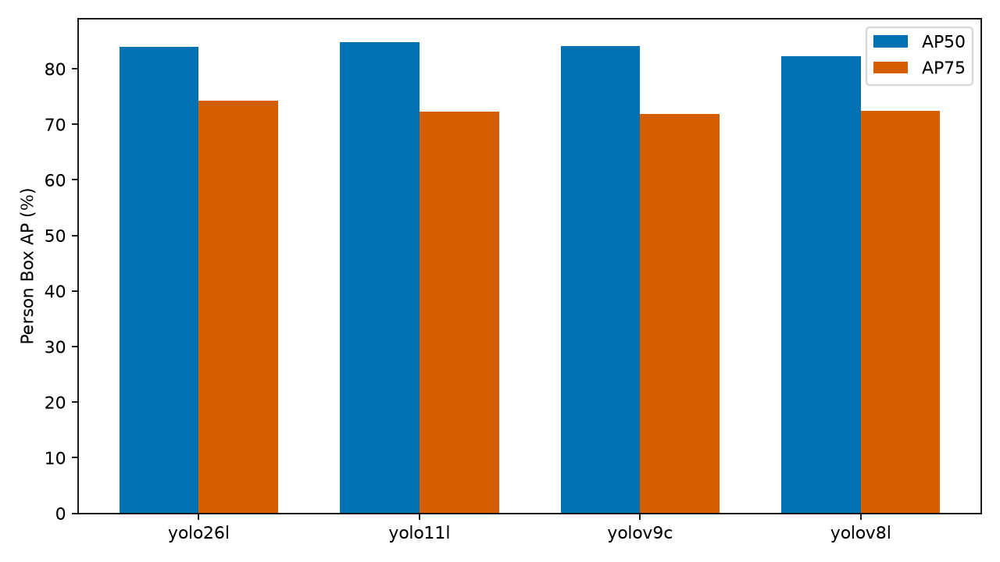
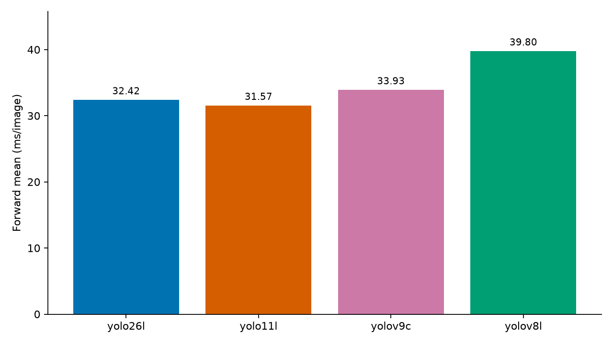
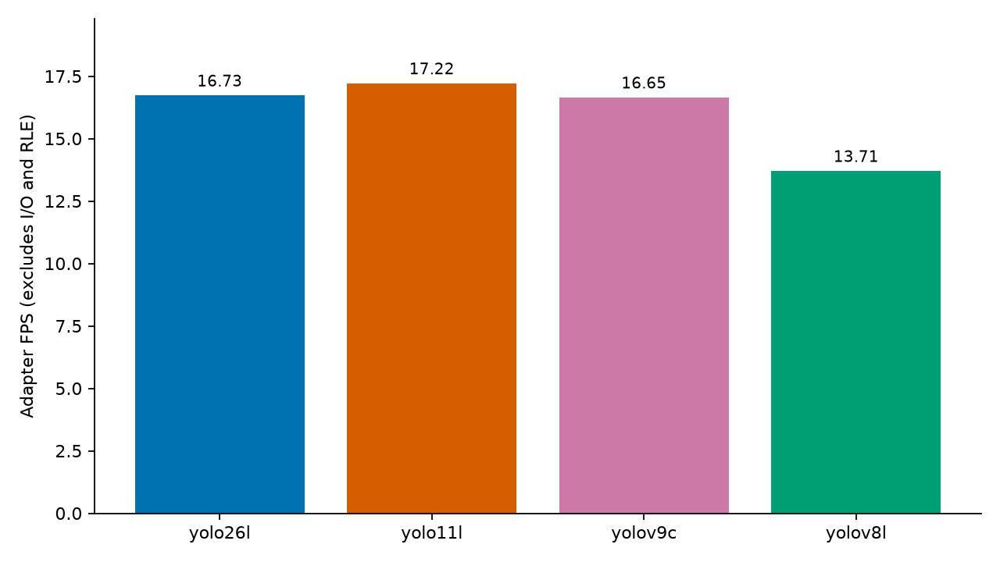
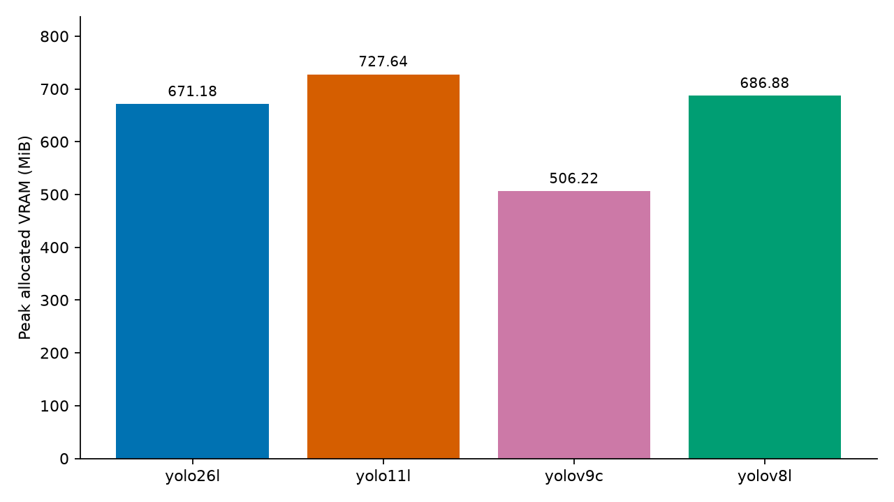
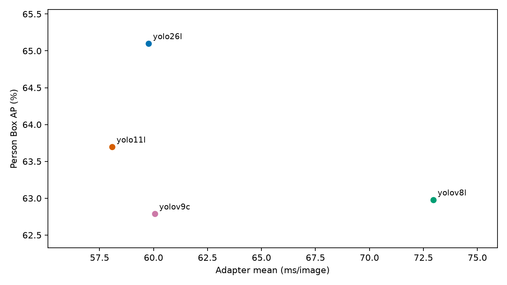

# Second-largest (L/C) — การวิเคราะห์ภาพและข้อผิดพลาด

## 1. ภาพรวมผลการทดลอง

4 โมเดลครบคุณภาพ 600 ภาพและ clean timing กลุ่มนี้มี AP สูงสุดใน yolo26l-seg.pt อ่านตัวเลขและบทบาทใน [สรุปผล](RESULTS_SUMMARY_TH.md)

## 2. วิธีอ่านหลักฐานภาพ

เลือกสี่กรณีหลังปิด benchmark จาก fixed sample 16 ภาพเดิม โดยดู coverage ของ GT/ฉากและรูปแบบ TP/FP/FN เพื่ออธิบายความต่างของ output มีทั้งกรณีที่แยกโมเดลได้ ข้อผิดพลาดร่วม และ negative control การเลือกภาพประกอบนี้ไม่เปลี่ยน population, settings หรือคะแนนหลัก

Case A/C/D ใช้ภาพร่วมกันทุก tier ส่วน Case B ของ Small ใช้ภาพทางเดินที่แยกพฤติกรรมของโมเดลได้ชัดกว่าอีกกรณีซึ่งผลเหมือนกันทุกตัว กลุ่มอื่นใช้ภาพที่มีโครงสร้างบังคน รวม 20 case slots จากภาพต้นทางต่างกันห้าภาพ รายการและเหตุผลอยู่ใน private selection manifest

ทุกภาพสร้างจาก original RGB และ lossless saved native masks เรียง Original/GT ตามด้วย YOLO26, YOLO11, YOLOv9 เฉพาะ X/E และ L/C แล้ว YOLOv8 มีทั้ง full frame และ ROI พิกัดเดียวกัน สีเขียว TP, แดง FP, ส้ม FN และเทา ignored prediction ใช้ confidence 0.25 และ bbox IoU 0.50 เดิม ภาพขยายปรับขนาดเพื่อแสดงผลแบบเดียวกันทุกโมเดล รายละเอียดที่เห็นยังจำกัดด้วยความละเอียดภาพต้นฉบับ

Person Mask AP ยังไม่มี GT รองรับ ภาพ mask ช่วยตรวจรูปแบบ output และ map-back ส่วนการตัดสิน TP/FN ในเอกสารนี้ยึด bbox matching ราย GT ที่ตรวจตรงกับ canonical per-image CSV

## 3. ผลรวมของชุดภาพประกอบ

| Model | TP รวม 4 ภาพ | FP รวม 4 ภาพ | FN รวม 4 ภาพ | IGN รวม 4 ภาพ |
| --- | --- | --- | --- | --- |
| yolo26l-seg.pt | 3 | 1 | 3 | 0 |
| yolo11l-seg.pt | 3 | 0 | 3 | 1 |
| yolov9c-seg.pt | 3 | 0 | 3 | 0 |
| yolov8l-seg.pt | 2 | 1 | 4 | 0 |

ตัวเลขนี้รวมสี่ภาพต้นทางเดียวกัน GT เข้าเกณฑ์รวม 6 รายการ ใช้เป็น diagnostics ที่อ่านคู่กับภาพ ส่วนผล headline ยังคงประชากร 600 ภาพ ภาพและ IDs จริงเก็บ private ตามนโยบาย dataset

## Case A — คนถูกตัดด้วยขอบภาพ

**เหตุผลเลือก** ตรวจการคืนพิกัดและ visible bbox เมื่อเห็นคนเพียงบางส่วน ใช้ภาพและ ROI เดียวกันครบทุกโมเดลในกลุ่ม

**สิ่งที่ตรวจจาก saved output** ทุกโมเดลจับคู่ eligible GT ที่มีในกรณีนี้ได้ครบ และไม่พบ unmatched FP ที่ operating point เดิม ผลราย GT และ candidate IoU ตรวจเทียบกับ counts เดิมแล้วอยู่ในหลักฐาน private

**การตีความ** GT ของคนที่ชนขอบเฟรมล้อมส่วนที่มองเห็น การคืนพิกัดและการจับคู่ต้องใช้พิกัดภาพต้นฉบับเดียวกัน กรอบที่เห็นอยู่บนคนอาจผ่าน confidence แต่ยังไม่ผ่าน IoU จึงต้องอ่าน candidate/matched IoU ประกอบ

**ใช้ประกอบการเลือก** ดูความครบถ้วนของคนพร้อมผลส่วนเกินที่ downstream pipeline ต้องรับ ไม่ใช้กรณีนี้แทนคะแนน 600 ภาพ หรือใช้ภาพประเมิน latency/VRAM

## Case B — คนอยู่หลังโครงสร้างบัง

**เหตุผลเลือก** ตรวจ GT หลายคนและกรอบส่วนเกินในฉากที่มีโครงสร้างพาดผ่าน ใช้ภาพและ ROI เดียวกันครบทุกโมเดลในกลุ่ม

**สิ่งที่ตรวจจาก saved output** มี FN ใน yolov8l-seg.pt มี unmatched FP ใน yolo26l-seg.pt, yolov8l-seg.pt ผลราย GT และ candidate IoU ตรวจเทียบกับ counts เดิมแล้วอยู่ในหลักฐาน private

**การตีความ** คนถูกโครงสร้างพาดผ่านและมีมากกว่าหนึ่ง GT ในภาพ การได้ TP ครบต้องดูกรอบส่วนเกินควบคู่กัน FP อาจอยู่บนคนที่มีคู่แล้ว จึงไม่ใช้จำนวน output แทนจำนวนคนที่เก็บได้

**ใช้ประกอบการเลือก** ดูความครบถ้วนของคนพร้อมผลส่วนเกินที่ downstream pipeline ต้องรับ ไม่ใช้กรณีนี้แทนคะแนน 600 ภาพ หรือใช้ภาพประเมิน latency/VRAM

## Case C — คนหลายขนาดร่วมกับ ignore

**เหตุผลเลือก** ตรวจคนขนาดเล็กและความต่างระหว่าง FN, FP กับ ignored prediction ใช้ภาพและ ROI เดียวกันครบทุกโมเดลในกลุ่ม

**สิ่งที่ตรวจจาก saved output** มี FN ใน yolo26l-seg.pt, yolo11l-seg.pt, yolov9c-seg.pt, yolov8l-seg.pt และไม่พบ unmatched FP ที่ operating point เดิม ส่วน yolo11l-seg.pt มี prediction ที่เข้ากติกา ignore ผลราย GT และ candidate IoU ตรวจเทียบกับ counts เดิมแล้วอยู่ในหลักฐาน private

**การตีความ** มี GT หลายขนาดและพื้นที่ ignore ในภาพเดียวกัน ข้อผิดพลาดร่วมในภาพนี้แสดงกรณีที่คะแนนเฉลี่ยสูงยังพลาดได้ ภาพนี้ยังไม่แยกสาเหตุด้านแสง ขนาด และการบดบังออกจากกัน Ignored prediction ต้องแยกจาก FP และยังไม่ชดเชย FN ของ valid GT

**ใช้ประกอบการเลือก** ดูความครบถ้วนของคนพร้อมผลส่วนเกินที่ downstream pipeline ต้องรับ ไม่ใช้กรณีนี้แทนคะแนน 600 ภาพ หรือใช้ภาพประเมิน latency/VRAM

## Case D — ภาพไม่มี eligible GT

**เหตุผลเลือก** ตรวจ negative control ภายใต้ inventory ที่รับรอง ใช้ภาพและ ROI เดียวกันครบทุกโมเดลในกลุ่ม

**สิ่งที่ตรวจจาก saved output** กรณีนี้ไม่มี eligible GT ตาม inventory ที่รับรอง และไม่พบ unmatched FP ที่ operating point เดิม ผลราย GT และ candidate IoU ตรวจเทียบกับ counts เดิมแล้วอยู่ในหลักฐาน private

**การตีความ** เป็น negative control ตาม inventory ที่รับรอง เกณฑ์ confidence ยังคง 0.25 การไม่เหลือกรอบผ่านเกณฑ์ในภาพนี้ใช้ตรวจการทำงานบน negative frame แต่ยังไม่ยืนยันอัตรา false alarm ของฉากประเภทนี้ทั้งชุด

**ใช้ประกอบการเลือก** ดูความครบถ้วนของคนพร้อมผลส่วนเกินที่ downstream pipeline ต้องรับ ไม่ใช้กรณีนี้แทนคะแนน 600 ภาพ หรือใช้ภาพประเมิน latency/VRAM

## 4. สิ่งที่ตัวเลขรวมกับภาพบอกต่างกัน

AP รวมสรุป ranking และคุณภาพกรอบหลาย IoU ส่วนภาพสี่กรณีช่วยตรวจว่า FN/FP อยู่บนคนใดและบริเวณใด TP เท่ากันอาจจับคนต่างชุดและ mask รูปร่างต่างกัน การชนะ AP จึงไม่ได้รับรองว่าเก็บ GT ทุกคนในทุกภาพได้ดีกว่า

## 5. ความเร็วและหน่วยความจำ

กราฟนี้มาจาก clean benchmark measurements ภาพ segmentation ใช้อธิบายเวลาหรือ memory โดยตรงไม่ได้ รายละเอียด stage distributions อยู่ใน REPORT.md

## 6. Near-tie และข้อเสนอการเลือก

| โมเดล | จุดเด่นที่วัดได้ | ข้อแลกเปลี่ยน | เงื่อนไขการเลือก |
| --- | --- | --- | --- |
| yolo26l-seg.pt | Box AP สูงสุดในกลุ่ม | Recall ห่างตัวนำ 0.130 pp, adapter เพิ่ม 1.687 ms, VRAM เพิ่ม 164.966 MiB | เน้น Box AP |
| yolo11l-seg.pt | Precision สูงสุด, Recall สูงสุด, forward เร็วสุดในกลุ่ม, adapter เร็วสุดในกลุ่ม | AP ห่างตัวนำ 1.403 pp, VRAM เพิ่ม 221.423 MiB | ลดสัดส่วนกรอบเกิน, เก็บคนให้ครบ, จำกัดเวลา adapter |
| yolov9c-seg.pt | allocated VRAM ต่ำสุดในกลุ่ม | AP ห่างตัวนำ 2.311 pp, Recall ห่างตัวนำ 3.121 pp, adapter เพิ่ม 1.978 ms | จำกัด allocated VRAM |
| yolov8l-seg.pt | AP 62.978% และ Recall 76.723% | AP ห่างตัวนำ 2.121 pp, Recall ห่างตัวนำ 1.951 pp, adapter เพิ่ม 14.875 ms | ใช้เป็นจุดอ้างอิงของ checkpoint ในกลุ่มนี้ |

อ่านคู่ near-tie จาก [ตารางความต่าง](https://github.com/folklazy/YOLO_Instance_Segmentation_CCTV600_Scaling_Study/blob/main/metrics/NEAR_TIES.csv) เมื่อมีคู่เข้าเกณฑ์ AP ห่างไม่เกิน 0.1 pp ให้ตรวจ per-GT output ในภาพเดียวกันเพิ่ม การที่ไม่เข้าเกณฑ์ near-tie ยังไม่ใช่หลักฐาน statistical significance

## 7. ข้อจำกัด

GT ใช้ visible bbox ของคนด้านยาว ≥50 px รวม 769 คน การรับรอง person inventory อิงการตรวจรับของผู้จัดทำ dataset ยังไม่มี independent inventory review ครบชุด ขนาดโมเดลและข้อมูล pretraining ต่างกัน การเปรียบเทียบนี้ยังไม่แยกสาเหตุทาง architecture ไม่มี uncertainty analysis และ Person Mask AP ต้องมี GT silhouette เพิ่ม ชุดภาพประกอบมีสี่ภาพที่เลือกตามประเภทกรณี จึงไม่ใช้ประมาณความถี่ข้อผิดพลาดของ dataset ทั้งชุด และการใช้ภาพเดิมข้าม tier ไม่เพิ่มจำนวนตัวอย่างอิสระ

## 8. เปิดหลักฐานภาพจริงในเครื่อง

จาก workspace เปิด `../YOLO_Instance_Segmentation_CCTV600_Scaling_Study/outputs/presentation-20261116T094620918214Z/cases/second_largest/index.html` เมื่อเริ่มจากโฟลเดอร์ repo นี้ หรือเปิด `PRESENTATION_CASES_TH.md` ในโฟลเดอร์เดียวกันเพื่ออ่าน counts และ IoU ราย GT ภาพทั้ง 16 เดิมยังอยู่ที่ `outputs/<original_run_id>/gallery/index.html`

ใน GitHub แสดงกราฟรวมและคำอธิบายที่ตัด IDs จริงออก ส่วนภาพ CCTV ใช้ private gallery ตามนโยบายเดิมของงานนี้

[ผลเชิงตัวเลข](RESULTS_SUMMARY_TH.md) · [รายงานเทคนิค](REPORT.md) · [Master](https://github.com/folklazy/YOLO_Instance_Segmentation_CCTV600_Scaling_Study)
